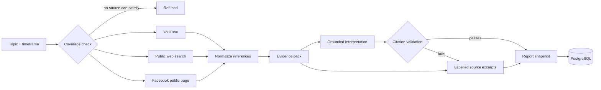
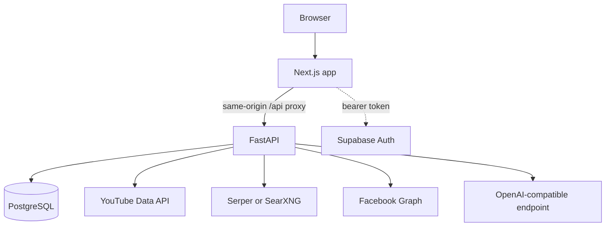

<div align="center">

# Trendora

**A research-first workspace for building a defensible picture of a topic before you write or plan anything about it.**

[](https://github.com/LexterMorgan/trendora/actions/workflows/ci.yml)


</div>

> Local alpha. No public deployment yet. AI prose quality is unverified.
> Reading, saving, and reopening research never requires a model call.

---

## The problem

Search results are fragmented, often undated, and easy to over-read. A person
who needs to write or plan something usually ends up with a pile of tabs and no
record of which source supported which sentence.

Trendora collects material for one topic and one window, shows what each source
actually supports, and keeps the limits visible instead of hiding them. The
report is meant to be useful on its own.

**Who it is for:** one person doing marketing or research work, plus a small
shared workflow. Not company-wide content management.

---

## What it does

| Area | Behavior |
| --- | --- |
| **Research** | Topic plus timeframe. Collects material from the configured sources only. |
| **Grounded findings** | Findings cite supplied source text. Unsupported claims are refused, not softened. |
| **Ask this report** | A question against a saved report. Answers must cite references that report already holds. |
| **Run-over-run diff** | Compares findings with the nearest older report of the same topic. Exact match only. |
| **Discover** | Public-web gateway search. No YouTube, no AI, no scoring, no research handoff. |
| **Planner** | Save a report, then optionally develop ideas, briefs, and planned posts. |

Everything after saving is optional. Nothing publishes automatically.

---

## How a report is built



1. **Query.** Topic, markets, and a date window. Nothing runs without a source
   that can satisfy the request.
2. **Collection.** Configured retrievers only: YouTube, public web search, and
   Facebook public Pages. No scraping behind a login.
3. **Normalization.** Results become references with stable ids, a source code,
   and fields the reader can inspect.
4. **Evidence.** A bounded evidence pack is derived from those references:
   facts, observations, patterns.
5. **Interpretation.** An OpenAI-compatible endpoint writes findings that must
   cite supplied evidence. Findings may not contain recommendation language.
6. **Validation.** Findings with no resolvable citation are refused. If
   synthesis is unavailable, malformed, or rejected, the report falls back to
   labelled excerpt text instead of inventing prose.
7. **Snapshot.** The finished report is stored as one immutable row. Reading it
   later needs no model call.

---

## System architecture



The browser never calls the backend directly. Next.js route handlers proxy every
request same-origin and forward the bearer token, so cookies and CORS stay
simple. Every read is gated by session verification plus an active membership.

---

## Persistence

| Table | Holds |
| --- | --- |
| `research_reports` | One immutable snapshot per run: query, coverage, references, evidence, interpretation, strategy, ideation. |
| `planner_posts` | Planned content: title, platform, caption, brief, planned date, status, assignee. |
| `planner_post_origin_sources` | Which saved report a planner post came from. |
| `planner_post_activity` | Append-only activity log. |
| `memberships` | Who may read reports. |

Reports are append-only. Nothing edits a saved snapshot. Expiry is a separate,
explicit operation.

---

## Grounding rules

- Every finding must cite supplied evidence. An uncited finding is rejected,
  not softened.
- Citation validation proves the evidence was supplied. It does not prove a
  statement is true or significant.
- Findings may not contain recommendation or action language. Plans and ideas
  live in the optional ideation layer.
- "Ask this report" accepts only citations the saved report already holds.
  Anything else returns `422 ungrounded_answer`.
- Run-over-run diff is exact match after whitespace and case normalization.
  No fuzzy matching, no similarity score.

---

## Tech stack

### Backend


### Frontend


### Sources and AI


---

## Quick start

Python 3.12 and a project virtualenv are required, plus a PostgreSQL target.

Backend, in one terminal (no auto-reload by default):

```bash
.venv/bin/python -m uvicorn trendora.api.app:create_app --factory \
  --host 127.0.0.1 --port 8000
```

Frontend, in another terminal:

```bash
cd web
npm run dev -- --webpack --hostname 127.0.0.1 --port 3000
```

Open <http://127.0.0.1:3000>. Use the same `127.0.0.1` origin everywhere,
including the Supabase Site URL and redirect allowlist, or the session will not
resolve.

Neither command installs dependencies or migrates a database. Stop each server
with Ctrl+C in its own terminal; do not use `pkill` patterns or old PIDs.

Required variable names, the search container, and the optional AI router are
covered in [docs/DEPLOYMENT.md](docs/DEPLOYMENT.md).

## Tests

```bash
.venv/bin/python -m pytest tests/unit -q     # offline, guarded, no services
cd web && npm test                           # frontend unit tests
cd web && npm run lint && npx tsc --noEmit   # lint and typecheck
```

CI runs the offline unit suite, typecheck, and Next route type generation on
every push. Database-backed integration tests need an explicitly approved
disposable target; see [docs/10_TESTING_EVALUATION.md](docs/10_TESTING_EVALUATION.md).

## Evaluating reports

The evaluator is offline and structural. It never calls a model or the network.

```bash
.venv/bin/python -m trendora.research.evaluation \
  --corpus tests/fixtures/research_quality/cases.json
```

Seven adversarial fixture cases, one finding each:

| Case | Citations | Resolved | Text support |
| --- | ---: | ---: | --- |
| exact_description_citation | 1 | 1 | yes |
| title_description_mismatch | 1 | 1 | yes (known gap) |
| unsupported_specific_claim | 2 | 2 | no |
| publication_event_date_confusion | 1 | 1 | no |
| promotional_attribution | 1 | 1 | no |
| missing_evidence | 1 | 0 | no |
| extractive_fallback | 1 | 1 | yes |

Aggregate: 7 of 8 citations resolve, 3 of 7 findings carry text support.
Resolution proves the cited value exists in the report; it does not prove the
claim is true. The known gap is `title_description_mismatch`: support matching
reads reference text rather than the exact cited field, so a mis-cited field can
still pass.

## Major limitations

- **Freshness.** Publication dates are often unknown, and public-web search does
  not enforce the requested timeframe, so its results stay labelled unverified.
- **Coverage.** Indexed public results are not authenticated scraping and are not
  a complete feed of any platform.
- **Evidence honesty.** Citation validation proves the cited evidence was
  supplied. It does not prove a statement is true or significant.
- **Attention claims.** Current counts and sample prevalence describe the
  returned sample. They do not show growth, and no trend score is invented.
- **Known limits.** Reference selection is bounded at 24 references and is
  source-fair, so a limit below the source count cannot cover every source;
  whitespace-only text is never treated as evidence.
- **Live verification.** AI prose quality and full deployment have not been
  verified. Local operation is not public deployment, and local-first is not
  offline operation.

## Documentation

Start at [docs/README.md](docs/README.md), which states which documents are
authoritative and which are historical.

- [docs/14_PRODUCT_ARCHITECTURE_REBASELINE.md](docs/14_PRODUCT_ARCHITECTURE_REBASELINE.md)
  is the authoritative product scope, capability status, and known gaps.
- [docs/01_ARCHITECTURE.md](docs/01_ARCHITECTURE.md) covers services, data flow,
  persistence, and access boundaries.
- [docs/DEPLOYMENT.md](docs/DEPLOYMENT.md) covers local operation and deployment
  prerequisites.
- [docs/10_TESTING_EVALUATION.md](docs/10_TESTING_EVALUATION.md) covers tests.
- [docs/archive/](docs/archive/README.md) holds superseded milestone records.
  Do not drive new work from them.

## Repository layout

```text
src/trendora/          # backend package
  api/                 #   FastAPI app, auth, research, planner, ask and diff routes
  research/            #   query, coverage, retrievers, evidence, interpretation, saving
  connectors/          #   YouTube, web search, Facebook, plus legacy ingestion clients
  analytics/           #   legacy analytics read layer
  forecasting/         #   legacy forecasting
  models/              #   SQLAlchemy models
  planner.py           #   planner records and report import
  retention.py         #   explicit, dry-run-first expiry
web/                   # Next.js research workspace, report reader, discover, planner UI
alembic/               # migrations
tests/unit/            # offline, guarded
tests/integration/     # requires an approved disposable database
docs/                  # current guides and the historical archive
deploy/                # search container configuration
```

## License

MIT — see [LICENSE](LICENSE).
