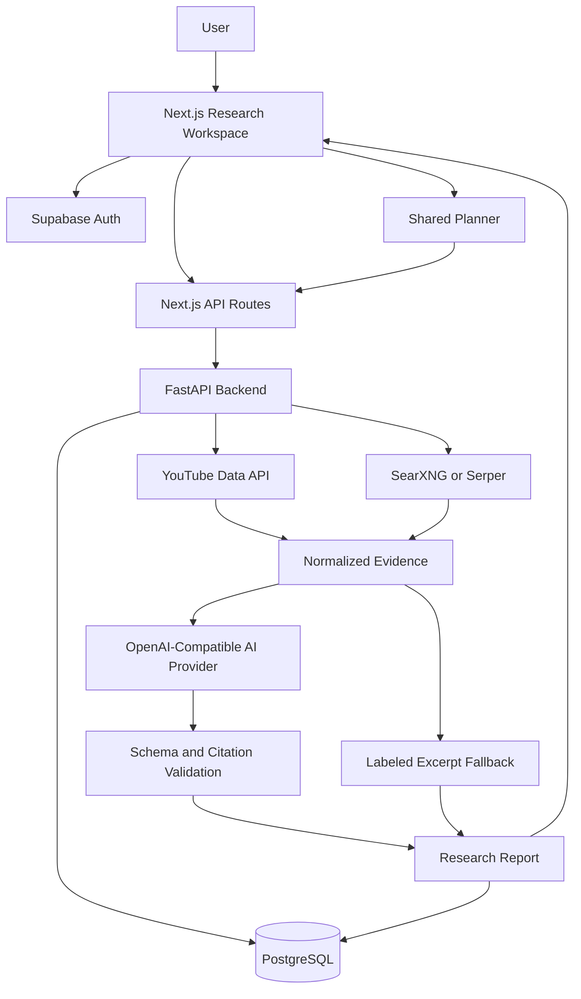

# Trendora

A research workspace for collecting information from YouTube and the public web, reviewing source-backed AI interpretations, and developing research into content.

Trendora brings source discovery, evidence review, saved reports, and a shared content planner into one workflow. It is designed for personal research and small marketing teams that need to understand a topic before deciding what to create.

**Current stage:** Local-first application under active development. Research, saved reports, and planner workflows are implemented. Public deployment and broader operational readiness remain separate work.

[Product Specification](docs/14_PRODUCT_ARCHITECTURE_REBASELINE.md) · [Deployment Guide](docs/DEPLOYMENT.md) · [Frontend Documentation](web/README.md)

---

## Business Problem

Research for content planning often happens across disconnected tools: search engines, YouTube, social platforms, notes, and spreadsheets.

Finding links is only one part of the work. Researchers also need to understand:

- What the collected sources actually say.
- Which claims have supporting references.
- Whether information falls within the requested period.
- Which sources were searched and which were unavailable.
- How useful research can become a content idea without losing its origin.

Trendora organizes this work around a practical question:

> What does the available evidence say about this topic, and what can I responsibly do with it?

The product is research-first. Content generation and planning are optional steps after reviewing the evidence.

## Research Workflow

```text
Topic + Timeframe
        ↓
YouTube + Public-Web Discovery
        ↓
Normalized References and Evidence
        ↓
AI Interpretation and Citation Validation
        ↓
Research Report
        ├── Read findings and inspect sources
        ├── Save and reopen from history
        └── Generate optional content ideas and briefs
                         ↓
                  Shared Content Planner
```

If AI interpretation is unavailable or fails validation, Trendora can display clearly labeled source-attributed excerpts instead.

An excerpt fallback is not presented as AI synthesis.

---

## Core Capabilities

### Global Topic Research

The main research form uses a topic and timeframe, without requiring country, source, or advanced configuration choices.

Requests use the configured YouTube and public-web sources. Global scope means no country restriction is applied; it does not mean the result set represents the entire world or internet.

Example research topics include:

- AI tools for education.
- Changes in creator workflows.
- Gaming products and communities.
- Fashion-related discussions.
- Marketing tools and industry developments.

Results are bounded samples, not exhaustive monitoring feeds.

### Multi-Source Discovery

| Source | Integration | Available material |
| --- | --- | --- |
| YouTube | YouTube Data API | Video titles, descriptions, publication dates, channel information, and available engagement metrics |
| Public web | Self-hosted SearXNG | Indexed URLs, page titles, and search snippets |
| Public web | Optional Serper adapter | Search-result URLs, titles, and snippets |

The web-search backend is configurable. Explicitly selecting SearXNG does not silently switch to Serper if the local service fails.

If one source fails and another succeeds, the report identifies partial coverage. A failed or skipped source is not presented as successfully searched.

#### Public Social Discovery

The SearXNG integration includes platform-targeted searches for public results from:

- Reddit.
- TikTok.
- Instagram.
- X and Twitter.
- LinkedIn.
- Facebook.

These results remain public-web references. Platform labels come from the returned hostname.

This is search-engine discovery of indexed public content, not authenticated social-platform access or direct full-post scraping. Availability depends on indexing, upstream search engines, and the report's result budget. Every platform is not guaranteed to appear in every report.

### Evidence-Aware Reports

Reports separate different kinds of output:

| Section | Meaning |
| --- | --- |
| Research findings | Interpretations with resolvable supporting title or description evidence |
| AI observations about the sample | Interpretations supported by sample patterns, observations, or valid metrics |
| Interpretations with limited evidence | Retained interpretations whose citations are missing, incomplete, or insufficient for the other categories |
| Source-attributed excerpts | Source text shown when research synthesis is unavailable or rejected |

Citation traces connect interpretations to the underlying evidence and references.

These checks establish structural support. They do not prove that an AI statement is true or that the cited text logically supports every part of its wording. Users should inspect important claims at their original sources.

### Source Cards and Previews

Source cards show the information needed to evaluate a reference:

- Title and original URL.
- Source or platform identity.
- Publication date, where available.
- Collection details and coverage caveats.
- Available source metrics.
- Expandable supporting information.

YouTube cards request higher-resolution thumbnails first and fall back to smaller versions when necessary. If no usable thumbnail loads, the text and source link remain available.

Public-web results currently use text-based cards without image previews.

YouTube thumbnails load directly from `i.ytimg.com`. Requests omit the referrer, but the image host still receives the viewer's IP address.

### Saved Research

Research reports can be saved and reopened from history.

Reports are stored as snapshots, separate from editable planner records. The interface distinguishes a successfully generated report from a successfully saved report and provides recovery behavior for supported persistence failures.

History visibility and data retention are different concerns. Hiding a report from a history window does not itself delete the underlying data.

### Optional Content Development

Users can request content ideas and creative briefs after choosing to include content tools.

Generated material retains its source references and can be imported into the planner. Content-tool failures do not require discarding otherwise available research.

Research-only requests do not need to run the optional strategy and ideation stages.

### Shared Content Planner

The planner supports manual drafting and research-to-content handoff.

Saved posts can contain:

- Title.
- Platform.
- Caption and hook.
- Creative brief.
- Asset links.
- Notes.
- Planned publishing date.
- Assignment to an active member.

The current planner supports **Idea** and **Working on it** statuses, along with active and archived records.

Active members can read and edit the shared planner. Revision checks help prevent concurrent edits from silently overwriting newer changes.

Planner editing and saving do not require an AI completion, although the application backend, authentication, and database must remain available.

A planned date is a reminder for the workflow. Trendora does not automatically publish the post.

---

## Architecture



### Application Boundaries

- The frontend handles research input, report reading, authentication UI, and planner editing.
- Next.js API routes forward application requests to FastAPI.
- FastAPI handles research execution, validation, access checks, persistence, and planner operations.
- PostgreSQL stores report snapshots, memberships, planner records, and supporting data.
- Supabase provides authentication and can host the PostgreSQL database.
- Search and AI providers remain external dependencies with their own availability, quotas, and limits.

### AI Provider Integration

Trendora uses an OpenAI-compatible Chat Completions adapter.

A compatible gateway such as 9router can route requests to a configured model or combo alias. Compatibility still depends on the upstream models returning responses that satisfy Trendora's schemas and grounding checks.

The AI pipeline uses a shared monotonic deadline across interpretation, supported retries, and optional content stages. In-flight HTTP operations use the remaining budget.

This does not guarantee that the entire report finishes within that budget. Collection, local parsing, validation, persistence, and cleanup also take time. Cancelling Trendora's request does not guarantee cancellation of work already running inside an upstream router.

## Technology Stack

| Layer | Technology |
| --- | --- |
| Frontend | Next.js, React, TypeScript |
| Backend | Python 3.12+, FastAPI, Uvicorn |
| Data validation | Pydantic |
| Database | PostgreSQL |
| Persistence | SQLAlchemy, psycopg |
| Migrations | Alembic |
| Authentication | Supabase Auth |
| Public-web discovery | SearXNG or Serper |
| Video discovery | YouTube Data API |
| AI execution | OpenAI-compatible Chat Completions |
| Backend tests | pytest |
| Frontend checks | Node test runner, TypeScript, ESLint |
| Browser regressions | Playwright-compatible isolated harness |

## Repository Structure

```text
trendora/
├── src/trendora/
│   ├── api/                 # HTTP routes, authentication, request validation
│   ├── connectors/          # External-source adapters
│   ├── research/            # Retrieval, evidence, interpretation, reports
│   ├── models/              # Database models
│   ├── db/                  # Database engine and session management
│   ├── planner.py           # Shared planner operations
│   ├── planner_origin.py    # Imported research provenance
│   ├── analytics/           # Historical observation analysis
│   ├── forecasting/         # Forecasting baselines
│   ├── diagnostics/         # Time-series diagnostics
│   └── product/             # Forecast product contracts
├── web/
│   ├── app/                 # Pages and Next.js API routes
│   ├── components/          # Research, report, auth, and planner UI
│   ├── lib/                 # Client helpers and evidence resolution
│   └── tests/               # Unit and browser regression coverage
├── alembic/                 # Database migrations
├── deploy/searxng/          # Local search-service configuration
├── tests/
│   ├── unit/
│   └── integration/
└── docs/                    # Product, architecture, and operational guides
```

The repository also contains earlier ingestion, analytics, and forecasting work, including Hacker News, Stack Exchange, and GitHub connectors. These are separate from the default YouTube and public-web research workflow.

---

## Running Locally

### Prerequisites

- Python 3.12 or newer.
- Node.js and npm. The frontend test command requires a Node version capable of running the repository's TypeScript tests.
- A configured PostgreSQL database and Supabase Auth project.
- YouTube API credentials for YouTube research.
- SearXNG or Serper configuration for public-web research.
- A compatible AI endpoint for generated interpretations.

A container runtime is needed only when running SearXNG in a container. On macOS, Colima is one option.

### 1. Clone and Install

```bash
git clone https://github.com/LexterMorgan/trendora.git
cd trendora

python3.12 -m venv .venv
.venv/bin/python -m pip install -e ".[dev]"

cd web
npm ci
cd ..
```

### 2. Configure the Backend

For a fresh checkout, copy `.env.example` to `.env`. Do not overwrite an existing configuration.

Configure the relevant variables:

| Variable | Purpose |
| --- | --- |
| `DATABASE_URL` | PostgreSQL connection using the SQLAlchemy psycopg driver |
| `SUPABASE_URL` | Supabase project URL used by backend authentication |
| `YOUTUBE_API_KEY` | YouTube Data API access |
| `TRENDORA_WEB_SEARCH_BACKEND` | `searxng`, `serper`, `auto`, or `none` |
| `SEARXNG_URL` | Base URL of the configured SearXNG instance |
| `SERPER_API_KEY` | Required when using Serper |
| `TRENDORA_AI_PROVIDER` | Provider identifier |
| `TRENDORA_AI_MODEL` | Model name or gateway combo alias |
| `TRENDORA_AI_ENDPOINT_URL` | Complete Chat Completions endpoint |
| `TRENDORA_AI_API_KEY` | AI endpoint credential |
| `TRENDORA_AI_TIMEOUT_SECONDS` | Shared AI request deadline setting |
| `TRENDORA_REPORT_RECOVERY_SIGNING_KEY` | Stable signing secret for report recovery |

The AI endpoint must include the complete path, such as `/v1/chat/completions`; the adapter does not append it automatically.

Keep credentials in local environment files or the deployment platform's secret store. Never commit real keys or database passwords.

### 3. Configure the Frontend

Create `web/.env.local` with your project settings:

```dotenv
TRENDORA_API_BASE_URL=http://127.0.0.1:8000
NEXT_PUBLIC_SUPABASE_URL=https://YOUR_PROJECT.supabase.co
NEXT_PUBLIC_SUPABASE_ANON_KEY=YOUR_PUBLIC_ANON_OR_PUBLISHABLE_KEY
```

Only public Supabase client configuration belongs in `NEXT_PUBLIC_*` variables. Never place a service-role key, database password, or AI credential there.

### 4. Prepare Authentication and the Database

Follow the [deployment guide](docs/DEPLOYMENT.md) before applying migrations to an existing database.

For a fresh or explicitly approved target:

```bash
.venv/bin/alembic upgrade head
.venv/bin/alembic current
```

Back up existing data before migration and review the documented migration compatibility notes.

Configure local authentication URLs consistently:

```text
Site URL:
http://127.0.0.1:3000/

Allowed redirects:
http://127.0.0.1:3000/accept-invite
http://127.0.0.1:3000/reset-password
```

For a private workspace, disable public signup and provision authorized accounts through a trusted administrative workflow.

An Auth account also needs an active Trendora membership. Membership and administrator privileges must come from trusted application records, not user-editable metadata.

### 5. Start Supporting Services

If using SearXNG, start its container runtime and the Trendora search container using [the SearXNG setup instructions](deploy/searxng/README.md).

Configure the backend to use it:

```dotenv
TRENDORA_WEB_SEARCH_BACKEND=searxng
SEARXNG_URL=http://127.0.0.1:8888
```

If using a local AI gateway such as 9router, start that gateway separately and confirm the configured endpoint and model alias.

SearXNG provides search results. It does not replace the AI provider.

### 6. Start the Backend

In the first terminal, from the repository root:

```bash
.venv/bin/python -m uvicorn trendora.api.app:create_app \
  --factory \
  --host 127.0.0.1 \
  --port 8000
```

The backend health endpoint is:

```text
http://127.0.0.1:8000/health
```

The command intentionally omits `--reload`. Enable automatic reload only when needed during development.

### 7. Start the Frontend

In a second terminal:

```bash
cd trendora/web
npm run dev -- --webpack --hostname 127.0.0.1 --port 3000
```

If the terminal is already at the repository root, use `cd web` instead.

Open:

```text
http://127.0.0.1:3000
```

Use the same hostname for browsing and Auth redirects. `localhost` and `127.0.0.1` are different browser origins and do not share the same session storage.

### Stopping Local Services

Press `Ctrl+C` in each frontend and backend terminal.

To stop the named SearXNG container:

```bash
docker stop trendora-searxng
```

If Colima is no longer needed:

```bash
colima stop
```

Stopping Colima stops every container in that Colima instance. Stop a local AI gateway separately if it is no longer needed.

Trendora does not need to run continuously. Stopping the local application does not delete saved database records.

If a port is already occupied, identify its listener before starting another instance:

```bash
lsof -nP -iTCP:3000 -sTCP:LISTEN
lsof -nP -iTCP:8000 -sTCP:LISTEN
```

Avoid broad process-killing commands that could stop unrelated projects.

---

## Testing and Validation

### Backend Unit Tests

From the repository root:

```bash
.venv/bin/python -m pytest tests/unit -q
```

### Frontend Checks

From `web/`:

```bash
npm test
npm run typecheck
npm run lint
npm run build -- --webpack
```

### Browser Regressions

```bash
npm run test:browser
```

The browser runner requires an installed Playwright-compatible driver and browser. It uses an isolated fixture environment with mocked application responses.

```bash
npm run test:browser:contract
```

The contract command checks browser-test module structure. It does not execute a browser and is not a substitute for browser acceptance tests.

### Database and Live Checks

PostgreSQL integration tests require an explicit test database. Destructive fixtures additionally require an approved disposable PostgreSQL target.

Never point disposable or destructive tests at the application database.

Live source and AI checks are separate from mocked tests. They may consume quotas or incur charges and should be run deliberately.

## Security and Data Handling

- Protected research and planner operations require authentication and membership checks.
- Report snapshots and editable planner posts use separate persistence models.
- Database grants and row-level security must be verified on the actual deployment target.
- Backend secrets stay outside browser bundles.
- Report recovery uses signed data and a dedicated signing key.
- History visibility does not replace retention cleanup.
- Provider credentials, report content, and operational backups require appropriate local and deployment access controls.

These are application design boundaries, not a claim of independent security certification.

## Current Limitations

- Search results are a bounded sample, not comprehensive internet coverage.
- Public-web publication dates remain unverified, and the requested timeframe is not enforced for those results.
- A high engagement count or common pattern does not establish growing attention over time.
- Citation validation does not prove semantic correctness.
- Public social discovery depends on search-engine indexing; it does not provide complete social feeds or private content.
- Full-page extraction, authenticated social scraping, and public-web image previews are not part of the current research flow.
- AI availability, response quality, latency, and free-tier access depend on external providers.
- The planner does not yet provide calendar or board views, approval workflows, published URLs, or actual publication dates.
- Automatic publishing, media uploads, and platform analytics integrations are not implemented.
- Local operation requires the relevant application and supporting services to be running.
- Production deployment requires its own authentication, migration, backup, retention, and hosting verification.

## Development Priorities

Future work should build on the existing research workflow:

- Improve source diversity and the usefulness of research summaries.
- Verify publication dates and improve timeframe filtering.
- Add carefully bounded public-page extraction where appropriate.
- Complete manual publication tracking in the planner.
- Reduce unnecessary provider input and improve cost visibility.
- Complete operational readiness before public hosting.

These are development directions, not shipped features or delivery commitments.

## Documentation

- [Product specification and current scope](docs/14_PRODUCT_ARCHITECTURE_REBASELINE.md)
- [Deployment and operational guidance](docs/DEPLOYMENT.md)
- [Frontend setup and behavior](web/README.md)
- [SearXNG configuration](deploy/searxng/README.md)
- [Research evidence contract](docs/19_EVIDENCE_CONTENT_OBSERVATIONS.md)
- [Grounded interpretation contract](docs/21_GROUNDED_AI_INTERPRETATION_CONTRACT.md)
- [Research report pipeline](docs/25_RESEARCH_REPORT_PIPELINE_API.md)

Older milestone documents describe the project's development history. Consult the current product specification and implementation before treating an older document as current behavior.

## Author

[Michael Alexander](https://github.com/LexterMorgan)

## License

Proprietary. This repository does not currently grant an open-source license.
